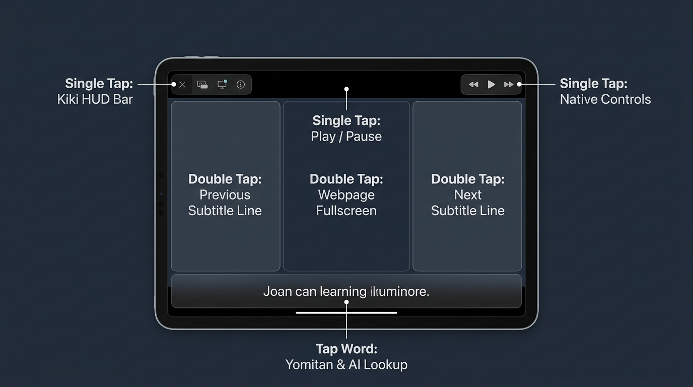

# Kiki Immersion

> *Touch & Mouse YouTube Immersion with Yomitan Dictionary Lookup, Translucent Liquid Glass Subtitles, AI Contextual Engine & Dynamic Hot-Reload.*

    

---

## 🚀 One-Click Installation

Installing Kiki Immersion is fully automated across all modern desktop and mobile browsers via userscript managers:

👉 **[Click Here to Install Kiki Immersion (loader.user.js)](https://raw.githubusercontent.com/kekeqwq/Kiki-Immersion/main/loader.user.js)**

- **Safari (iOS / iPadOS / macOS via Userscripts extension)**:  
  Tap or open the link above in Safari. The **Userscripts** extension panel will automatically detect the script and prompt an **Install** button. Tap **Install** to finish.
- **Chrome / Brave / Edge (via Tampermonkey / Violentmonkey)**:  
  Clicking the link will automatically open Tampermonkey's native installer interface. Click **Install** to finish.

*(Optional Standalone Bundle: If you prefer an entirely offline monolithic userscript without dynamic module fetching from GitHub, you can install [`dist/kiki-immersion.user.js`](https://raw.githubusercontent.com/kekeqwq/Kiki-Immersion/main/dist/kiki-immersion.user.js)).*

---

## 📖 Initial Setup & Dictionary Installation

> [!IMPORTANT]
> **For offline dictionary lookup, install Yomitan dictionaries (`.zip` format) into the browser storage. AI-only subtitle lookup requires an AI API configuration, not an imported dictionary.**

### 1. YouTube Setup (Primary Platform)
1. Open **any YouTube video** in your browser.
2. Click or tap **⚙️ Settings** on the top Kiki HUD bar (or tap any subtitle word, then tap the Settings gear icon in the card header).
3. Switch to the **📖 Dictionaries** tab.
4. Drag and drop or browse to import your Yomitan `.zip` dictionary archives (e.g., *JMdict*, *Kenkyusha*, *OALD*, *Cambridge*, *Daijirin*, etc.).
5. The dictionaries are parsed and stored locally in browser offline storage (IndexedDB) with zero external network requests during lookup.

### 2. Universal Web Reading Setup (LingQ, News, Articles)
- Kiki Immersion is primarily crafted for **YouTube video immersion**, but also provides full **Universal Web Word Lookup** across all websites.
- **Per-Domain Storage Isolation**: Because web browsers enforce origin-isolated storage (IndexedDB / localStorage), dictionaries installed on `youtube.com` are sandboxed to YouTube.
- To use dictionary lookup on any other website (e.g., **LingQ**, Wikipedia, web readers):
  1. Open your target website.
  2. Hold the **`Ctrl`** key (or your customized modifier key configured in settings: `Ctrl`, `Alt/Option`, `Cmd/Meta`) and **click ANY word** on the page.
  3. The Yomitan floating card will appear. Click the **⚙️ Settings** icon in the card header.
  4. Go to **📖 Dictionaries** and import your dictionary `.zip` files for that site.
  5. Once imported, simply hold `Ctrl` and click any word to inspect definitions, play pronunciations, or explore AI contextual explanations instantly!

### 3. Netflix + asbplayer (AI Subtitle Lookup)
- Load text subtitles with **asbplayer**. Kiki supports both regular and fullscreen subtitle overlays; Netflix's image-only subtitles are not OCRed.
- Use your **existing Kiki modifier + click** on a subtitle word to open AI directly. Yomitan's separate shortcut remains unchanged.
- Configure the AI API key on **netflix.com** via `Alt/Option + K` → AI Configuration (or the card's settings button). Configuration is origin-local; settings on YouTube or app.asbplayer.dev are not automatically shared.
- AI receives every line of the current source subtitle, the current reference translation tracks, and up to two previous **observed** cues when available. Hidden transcript caches, player controls and ruby annotations are excluded.
- The context is frozen at lookup time, including for mode changes and follow-up questions. Seeking clears the preceding-cue history. Only playback paused by Kiki is resumed when the card closes.

---

## 👆 Touch & Gesture Controls Guide

Kiki Immersion features a touch-first design built specifically for iPad, tablet, and touch-screen immersion. The player is divided into responsive touch zones:



### Gesture Mapping Reference

| Screen Area / Gesture | Action | Description |
| :--- | :--- | :--- |
| **Subtitle Word Tap** | `Yomitan & AI Lookup` | Tap any word in the subtitle line to instantly open Yomitan definitions, pitch accent, audio pronunciation, and AI context. |
| **Double Tap (Left 28%)** | `← Previous Subtitle Line` | Instantly jump playback to the start of the previous subtitle line. |
| **Double Tap (Center 44%)** | `Webpage Fullscreen` | Smoothly toggles seamless webpage fullscreen mode. |
| **Double Tap (Right 28%)** | `Next Subtitle Line →` | Instantly advance playback to the next subtitle line. |
| **Single Tap (Top-Left 18%)** | `Toggle Kiki HUD Bar` | Shows or hides the top floating controller bar (Settings, Subtitles, CC Track selector, Reload). |
| **Single Tap (Top-Right 18%)** | `Toggle Native Controls` | Reveals YouTube's native player controls overlay. |
| **Single Tap (Center)** | `Play / Pause` | Toggles video playback smoothly with gesture debounce protection. |
| **Dismiss Lookup Card** | `Tap Outside Card` | Tapping anywhere outside an active dictionary/AI popup immediately dismisses it and cleanly resumes playback. |

### Keyboard Shortcuts (Desktop / Hardware Keyboards)
- **`A`**: Jump to previous subtitle line.
- **`D`**: Jump to next subtitle line.
- **`Space`**: Smooth Play / Pause toggle without page scroll.
- **`Ctrl + Click`** (on any web text or YouTube comments): Trigger instant Yomitan & AI lookup card.

---

## ✨ Features & Highlights

1. **Catppuccin UI (Latte & Macchiato)**
   - **Light: Catppuccin Latte** (`catppuccin_latte`); **Dark: Catppuccin Macchiato** (`catppuccin_macchiato`), using the official palette with Mauve accents.
   - Shared tokens cover dictionary/AI cards, settings tabs and forms, subtitle overlays and word highlights, HUD, track menus, notifications, loading/progress, and phrase waves. Only Kiki UI is themed; native Netflix/asbplayer/Yomitan interfaces are not recolored.
   - Settings → Appearance offers Auto (follow page, system fallback), Latte, and Macchiato. Open UI follows theme changes without discarding form drafts.
   - **Loader users upgrading from 1.1.x must update `loader.user.js` to 1.2.0 or newer** so the new shared `theme.js` module is loaded. Standalone users update `dist/kiki-immersion.user.js`.
   - Palette attribution: [Catppuccin](https://catppuccin.com/palette/), [MIT license](assets/CATPPUCCIN-LICENSE).

2. **First-Party Offline Yomitan Dictionary & Audio Engine**
   - High-performance client-side IndexedDB dictionary parser supporting standard Yomitan / Yomichan `.zip` files.
   - Offline audio pronunciation playback and pitch accent visual graphs.
   - Multi-word compound matching and automatic Japanese deinflection / English lemmatization.
   - Phrase underlines do not replace the clicked word. Only when the dictionary actually returns both word and phrase definitions, results are split into independent **Word** and **Phrases** blocks, each with a header toggle and entry count. Both open by default; collapse either or both without losing definitions. Word-only or phrase-only results retain the original card layout, regardless of nearby text or phrase underline hints. Each entry retains its own audio and Ask AI button, and settings/close controls stay outside the collapsible blocks.

3. **Contextual AI Explanations & Multi-Turn Chat**
   - OpenAI-compatible API support (DeepSeek, GPT-4o-mini, Claude, Ollama, etc.).
   - Automatically injects the clicked word and the exact video subtitle sentence context.
   - **Interactive Exploration Pills**: MarginNote 4 style one-tap exploration pills tailored to your sentence.
   - **Multi-Turn Chat**: Follow-up questions with full conversation memory directly inside the lookup card.
   - **Selectable & Copyable Answers**: Drag-select text, use the browser's Copy menu or Ctrl/Cmd+C, or copy each answer with its own button (including a fullscreen-compatible clipboard fallback).

4. **Rock-Solid Subtitle Pipeline**
   - YouTube PoToken bypass via native authenticated Transcript panel extraction.
   - Automatic subtitle line synchronization and track switching, without synthetic seeking events or delayed forced playback retries.
   - SPA video switches clear all subtitle/track caches; video-generation checks reject late requests, reused transcript panels and stale native textTracks. Empty live captions clear the displayed line.
   - Space toggles playback once per press, suppresses duplicate native handling, and leaves editable fields and focused controls alone.
   - Multi-word phrase matching and highlight in subtitles.

---

## 🛠 Project Structure

```text
Kiki-Immersion/
├── loader.user.js            # Universal auto-updating loader script
├── assets/
│   └── gesture_guide.jpg     # Touch gesture illustration diagram
├── modules/                  # Modular engine source code
│   ├── theme.js              # Shared Catppuccin Latte/Macchiato palette & UI styles
│   ├── core.js               # State, theme management, base styles & utilities
│   ├── yomitan.js            # Yomitan offline IndexedDB dictionary & audio
│   ├── ai.js                 # AI explanation engine, streaming & exploration pills
│   ├── ui.js                 # HUD bar, card layout, settings & update modal
│   ├── web.js                # Universal non-intrusive web word lookup
│   └── youtube.js            # YouTube DOM adapter, subtitle sync & touch gestures
├── manifest.json             # Module registry and metadata manifest
├── scripts/                  # Build and bundling scripts
│   ├── bundle.py             # Generates dist single-file bundle
│   └── build_all.py          # Build and sync utilities
└── dist/
    └── kiki-immersion.user.js # Standalone monolithic bundle (fully offline)
```

---

## 🧪 YouTube Playback / Navigation Regression Tests

```sh
node scripts/test_youtube_regressions.js
```

Runs production functions in a deterministic VM with mocked player/network state. Checks Space down/up/repeat, delayed-resume removal, media-event safety, video-generation invalidation (including A→B→A), in-flight fetches, transcript panel ownership, native textTracks, empty live captions, and old ResourceTiming/wire responses. These are isolated regressions, not live YouTube playback automation.

## 🧪 Netflix/asbplayer Regression Tests

Run the isolated headless Chromium fixture (set `CHROME_BIN` if needed):

```sh
python3 scripts/test_netflix_asbplayer.py
```

Or inspect it manually:

```sh
python3 scripts/bundle.py
python3 -m http.server 8766 --bind 127.0.0.1
```

Open `http://127.0.0.1:8766/test/netflix-asbplayer.html` in a clean browser profile **without an installed Kiki userscript** (the fixture already loads the bundle). Requests use a local mock SSE response, never a real API key. It checks multi-line/bilingual context, independent gestures, context snapshots and follow-ups, rich text, caret fallback, pause/resume, seek history, fullscreen class/host transitions, selection/clipboard behavior under Netflix's root `user-select: none`, and computed Latte/Macchiato colors across AI, settings, subtitles, HUD, and feedback. Theme tests also verify host-page isolation and unsaved form preservation. Fullscreen transitions in this fixture are modeled because synthetic clicks do not grant browser fullscreen activation.

---

## 📄 License

GPL-3.0 License. Open-source touch-first immersion player for YouTube and the modern web.
